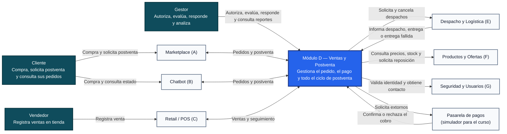

# Arquitectura C4: Diagrama de Contexto

> **Estado:** Propuesta para discusión del equipo, alineada con [specs/overview.md](../specs/overview.md), los contratos de API ([specs/api-contract.md](../specs/api-contract.md)) y el modelo de datos. No reemplaza las especificaciones funcionales vigentes.

Este documento presenta el nivel 1 del modelo C4 del Módulo D — Ventas y Postventa. Muestra, sin detalles técnicos, quiénes usan el sistema, con qué sistemas externos se integra y qué información intercambia con cada uno.

## 1. Diagrama de contexto

## 2. Personas y responsabilidades

| Persona | Qué entrega al sistema | Qué recibe del sistema |
|---|---|---|
| Cliente | Pedido, motivo de anulación o devolución, evidencia, calificación y reclamo, siempre a través de un canal | Confirmación y estado del pedido, resultado de su solicitud de postventa, encuesta y respuesta al reclamo |
| Vendedor | Registro de la venta en tienda mediante Retail / POS | Confirmación de la venta y seguimiento del pedido |
| Gestor | Autorización de anulaciones en `EN_PREPARACION`, dictamen de devoluciones y respuesta a reclamos | Bandejas de trabajo, historial del pedido, indicadores y reportes |

## 3. Sistemas externos e intercambios

| Sistema externo | Información recibida por el módulo | Información enviada por el módulo | Mecanismo | Funcionalidad |
|---|---|---|---|---|
| Marketplace (A) | Creación de pedido, anulación por pago no completado y solicitudes de postventa | Confirmación, estado e historial del pedido; resultado de la postventa | API REST síncrona | F1 a F6 |
| Chatbot (B) | Creación de pedido, consulta de estado y solicitudes de postventa | Confirmación y estado del pedido; resultado de la postventa | API REST síncrona | F1 a F6 |
| Retail / POS (C) | Registro de venta y consulta de seguimiento | Confirmación de venta y estado del pedido | API REST síncrona | F1 |
| Despacho y Logística (E) | Cambios de estado (`DESPACHADO`, `ENTREGADO`) y entrega fallida definitiva | Solicitud de despacho, cancelación de despacho al anular y logística de cambios de producto | Despacho llama a la API REST de M1; el módulo llama a la API de Despacho | F1, F2, F3 |
| Productos y Ofertas (F) | Precio y disponibilidad por ítem | Consulta al crear el pedido o aprobar un cambio; reposición de stock al anular | API REST síncrona | F1, F2, F3 |
| Seguridad y Usuarios (G) | JWT, roles, claves públicas y datos de contacto del cliente | Validación de tokens | Validación local del JWT (JWKS) y API REST | Todas |
| Pasarela de pagos (simulador) | Confirmación o rechazo del cobro; resultado del extorno | Solicitud de extorno con clave idempotente | Notificación HTTP hacia M1; API REST desde M2 | F1, F4 |

## 4. Límites del contexto

- El módulo es dueño del pedido, el pago declarado, las anulaciones, las devoluciones, los reembolsos, las calificaciones y los reclamos.
- Despacho y Logística conserva la propiedad del despacho, los repartidores, las rutas y las zonas.
- Productos y Ofertas conserva la propiedad del catálogo y el stock.
- Seguridad y Usuarios conserva la propiedad de las identidades, credenciales y roles.
- Marketplace, Chatbot y Retail son canales consumidores; no acceden a la consola del Gestor ni a los datos del módulo.
- No se integra una pasarela de pago real; se usa un simulador para efectos del curso (ESP-09, ESP-10).
- Una entrega fallida definitiva informada por Despacho anula el pedido en M1 (F2) y, si estaba pagado, genera un reembolso con origen `ANULACION` en M2 (F4).

## 5. Acuerdos externos pendientes

Antes de aprobar este contexto se debe confirmar con los otros equipos:

1. Con Despacho y Logística, que usarán `PATCH /api/v1/pedidos/{pedidoId}/estado` y `POST /api/v1/pedidos/{pedidoId}/eventos-logistica` con el scope `ventas:pedidos:estado`, y la ruta de su API para solicitar y cancelar despachos.
2. Con Marketplace y Chatbot, si las solicitudes de postventa llegarán siempre a través de ellos.
3. Con Productos y Ofertas, la ruta y el formato de la consulta de precio, disponibilidad y reposición de stock.
4. Con Seguridad y Usuarios, el emisor y los scopes del JWT, y los datos de contacto que expone.

## 6. Regla de lectura

Este diagrama responde únicamente a las preguntas **quién usa el sistema** y **con qué otros sistemas se comunica**. Los microservicios M1 y M2, la consola del Gestor, el API Gateway y la infraestructura pertenecen al nivel de contenedores ([c4-nivel-2-contenedores-ventas-postventa.md](c4-nivel-2-contenedores-ventas-postventa.md)).
