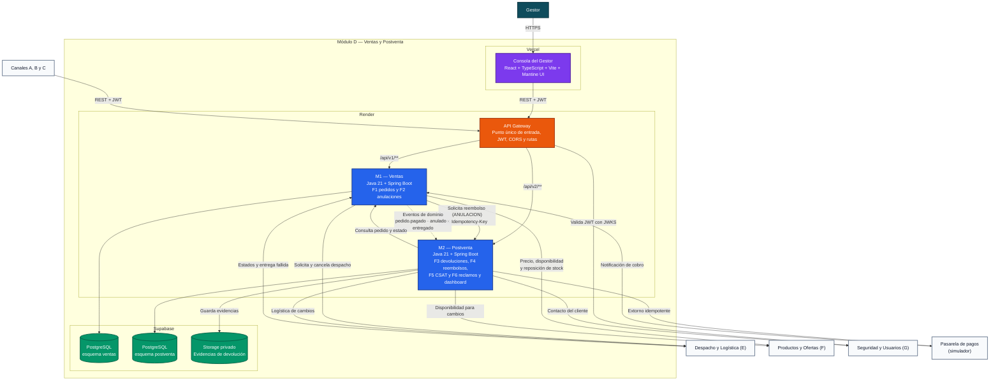

# Arquitectura C4: Diagrama de Contenedores

> **Estado:** Propuesta para discusión del equipo, alineada con [specs/overview.md](../specs/overview.md), [specs/stack-frontend.md](../specs/stack-frontend.md) y los contratos de API. Los proveedores de despliegue (Vercel, Render, Supabase) quedan sujetos a acuerdo del equipo.

Este documento presenta el nivel 2 del modelo C4: una consola web para el Gestor, un API Gateway, dos microservicios con persistencia aislada y sus integraciones externas.

## 1. Diagrama de contenedores



## 2. Catálogo de contenedores

| Contenedor | Responsabilidad | Tecnología prevista | Despliegue | Dependencias directas |
|---|---|---|---|---|
| Consola del Gestor | Bandejas de pedidos, anulaciones, devoluciones, reembolsos y reclamos; dashboard | React, TypeScript, Vite y Mantine UI ([stack-frontend.md](../specs/stack-frontend.md)) | Proyecto en Vercel | API Gateway |
| API Gateway | Única URL pública; enrutamiento por versión de API, CORS, validación de JWT y correlación | Java con componente Gateway compatible con Spring | Servicio en Render | Seguridad y Usuarios, M1, M2 |
| M1 — Ventas | Fuente única del estado del pedido: creación, consulta, máquina de estados, historial, eventos y anulaciones | Java 21, Spring Boot, Spring Web, Spring Security y JPA | Servicio en Render | Esquema `ventas`, M2, Productos, Despacho, Pasarela |
| M2 — Postventa | Devoluciones y cambios, reembolsos, encuesta CSAT, reclamos y dashboard | Java 21, Spring Boot, Spring Web, Spring Security y JPA | Servicio en Render | Esquema `postventa`, Storage, M1, Pasarela, Productos, Despacho, Seguridad |
| Esquema `ventas` | pedido, detalle_pedido, pago, historial_estado, anulacion | PostgreSQL administrado por Supabase | Esquema aislado | Solo M1 |
| Esquema `postventa` | devolucion, evidencia_devolucion, reembolso, reclamo, calificacion, agregado_ventas | PostgreSQL administrado por Supabase | Esquema aislado | Solo M2 |
| Evidencias | Fotografías y documentos de devoluciones | Supabase Storage privado | Bucket privado | Solo M2 |
| Simulador de pasarela | Simula cobros (avisa a M1) y extornos (los pide M2); sin base de datos, se comporta como sistema externo | Java 21, Spring Boot mínimo | Servicio propio en Render | M1 (recibe notificación de cobro), M2 (recibe solicitud de extorno) |

El modelo de datos de ambos esquemas está en [diseno/diagramas/bd/](../diseno/diagramas/bd/).

## 3. Responsabilidad de cada microservicio

### 3.1. M1 — Ventas

Responde **en qué estado está el pedido y qué transiciones son válidas**. Contrato: [api-ventas.md](../specs/api/api-ventas.md).

- F1, ESP-01: creación del pedido con sus bloques `canal`, `items`, `cupon`, `envio`, `contacto` y `pago`.
- F1, ESP-02: consulta por identificador y listado por cliente.
- F1, ESP-03: máquina de estados, matriz de transiciones e historial.
- F1, ESP-04: publicación de `pedido.pagado`, `pedido.anulado` y `pedido.entregado`.
- F2, ESP-05: registro de la anulación con motivo tipificado; directa en `CREADO` o `PAGADO`, con autorización del Gestor en `EN_PREPARACION`.
- F2, ESP-06: reposición de stock, cancelación de despacho y solicitud de reembolso a M2 cuando el pedido estaba pagado.

### 3.2. M2 — Postventa

Responde **qué ocurre con el pedido después de pagado o entregado**. Contrato: [api-postventas.md](../specs/api/api-postventas.md).

- F3, ESP-07 y ESP-08: devolución o cambio con evidencia y dictamen.
- F4, ESP-09 y ESP-10: reembolso idempotente contra el simulador de pasarela; solo acepta orígenes `ANULACION` (desde M1) y `DEVOLUCION` (desde F3).
- F5, ESP-11 y ESP-12: encuesta CSAT al recibir `pedido.entregado`.
- F6, ESP-13 a ESP-16: Libro de Reclamaciones con plazo de 15 días hábiles, dashboard y reportes.

M2 nunca escribe en el esquema `ventas`. Cuando necesita datos del pedido, los consulta a la API de M1.

## 4. Comunicaciones

| Interacción | Mecanismo | Referencia |
|---|---|---|
| Canal crea, consulta o anula un pedido | API REST síncrona mediante el Gateway (`/api/v1/pedidos`) | ESP-01, ESP-02, ESP-05 |
| Canal o Gestor opera postventa | API REST síncrona mediante el Gateway (`/api/v2/...`) | ESP-07 a ESP-16 |
| M1 solicita un cobro simulado | API REST síncrona hacia el simulador, inmediatamente después de crear el pedido con la reserva de stock confirmada — ningún canal invoca al simulador ni al webhook de notificación directamente | ESP-01 |
| Pasarela informa el resultado del cobro | `POST /api/v1/pedidos/{pedidoId}/pagos/notificacion` (scope `ventas:pagos:webhook`) | ESP-03 |
| Despacho informa estados | `PATCH /api/v1/pedidos/{pedidoId}/estado` (scope `ventas:pedidos:estado`, actor `SISTEMA_LOGISTICA`) | ESP-03 |
| Despacho informa entrega fallida definitiva | `POST /api/v1/pedidos/{pedidoId}/eventos-logistica`; M1 anula el pedido y solicita el reembolso | ESP-05, ESP-06 |
| M1 solicita un reembolso a M2 | `POST /api/v2/reembolsos` con `X-Idempotency-Key` y origen `ANULACION` (scope `postventa:reembolsos:procesar`) | ESP-06, ESP-09, RNF-08 |
| M1 comunica eventos de dominio a M2 | Bandeja de salida con identificador idempotente y reintentos | ESP-04, ESP-11, ESP-15 |
| M2 consulta un pedido | API REST interna de M1 | ESP-07 |
| M2 solicita un extorno | API REST síncrona con clave idempotente hacia el simulador | ESP-09, ESP-10 |
| Seguridad entrega identidad y roles | JWT validado localmente mediante JWKS | RNF-02 |

### 4.1. Eventos y bandeja de salida

No se incorpora un broker de mensajería. M1 registra cada evento en su bandeja de salida dentro de la misma transacción del cambio de estado. Un proceso posterior lo entrega a M2 y reintenta conservando el mismo identificador; M2 descarta los identificadores ya procesados.

## 5. Propiedad y aislamiento de datos (RNF-07)

- Cada microservicio utiliza una credencial de base de datos diferente.
- Un microservicio no consulta tablas ni esquemas del otro y no existen claves foráneas cruzadas.
- Para el curso se usa un único proyecto de Supabase con dos esquemas aislados: `ventas` y `postventa`.
- M2 conserva solo el identificador del pedido (`id_pedido`), sin relaciones JPA hacia las tablas de M1.
- Supabase Auth no se utiliza: la autenticación y los roles pertenecen al módulo Seguridad y Usuarios.
- El Gateway valida la firma y vigencia del token; cada microservicio vuelve a validar el scope, el rol y la propiedad del recurso.
- Las llamadas internas entre microservicios usan credenciales de servicio y no se exponen como rutas públicas del Gateway.

## 6. Flujo de evidencias de devolución

1. El canal envía el archivo a `POST /api/v2/devoluciones/evidencias/upload` (`multipart/form-data`, JPEG, PNG, WebP o PDF, máximo 5 MB).
2. M2 valida el JWT, el tipo y el tamaño del archivo, y lo guarda en el bucket privado.
3. M2 devuelve la URL de la evidencia.
4. El canal registra la devolución con `POST /api/v2/devoluciones`, incluyendo esa URL en el arreglo `evidencias`.
5. Para visualizarla, el Gestor recibe una URL firmada de corta vigencia.

## 7. Organización de repositorios y despliegues

```text
G5-Ventas-Postventas/
└── documentación funcional, C4, contratos y decisiones

frontend/
└── consola-gestor/

backend/
├── api-gateway/
├── servicio-ventas/
├── servicio-postventa/
├── simulador-pasarela/
└── pom.xml
```

| Repositorio | Aplicaciones | Despliegues previstos |
|---|---|---|
| `G5-Ventas-Postventas` | Documentación | Sin despliegue de ejecución |
| `frontend` | Consola del Gestor | Un proyecto en Vercel |
| `backend` | API Gateway, dos microservicios y el simulador de pasarela | Cuatro servicios en Render |

### 7.1. Configuración mínima por despliegue

| Despliegue | Directorio raíz sugerido | Configuración externa necesaria |
|---|---|---|
| Vercel: Consola del Gestor | `consola-gestor` | URL pública del API Gateway |
| Render: API Gateway | `api-gateway` | URL interna de ambos microservicios, origen CORS y datos para validar tokens |
| Render: M1 — Ventas | `servicio-ventas` | Conexión al esquema `ventas`, URL interna de M2, URLs de Productos y Despacho |
| Render: M2 — Postventa | `servicio-postventa` | Conexión al esquema `postventa`, URL interna de M1, URL del simulador, URLs de Productos, Despacho y Seguridad, credenciales de Storage |
| Render: Simulador de pasarela | `simulador-pasarela` | URL interna de M1 (para avisar el resultado del cobro); sin conexión a base de datos ni validación de JWT |

Los secretos se configuran únicamente en Render. Nunca se incorporan al código fuente ni a las variables públicas de Vercel.

## 8. Decisiones que el equipo debe cerrar

| Decisión | Recomendación para discutir | Cuándo cambiarla |
|---|---|---|
| Rutas y scopes que usará Despacho | Los endpoints y scopes ya definidos en api-ventas.md | Si Despacho propone otro contrato |
| Mensajería de eventos | Bandeja de salida sin broker | Incorporar un broker si aparecen más consumidores |
| Base de datos | Un proyecto Supabase con dos esquemas y credenciales aisladas | Separar proyectos si se necesita aislamiento físico |
| Autenticación | Consumir JWT de Seguridad; no usar Supabase Auth | Solo por acuerdo con Seguridad y Usuarios |

**Resuelto:** el simulador de pasarela es un servicio propio en Render (`simulador-pasarela`, puerto 8083), a cargo de Johan (F5). No tiene base de datos, no valida JWT y no importa código de M1 ni M2 — se comunica solo por HTTP, comportándose como un sistema externo aunque lo construya el propio equipo.
