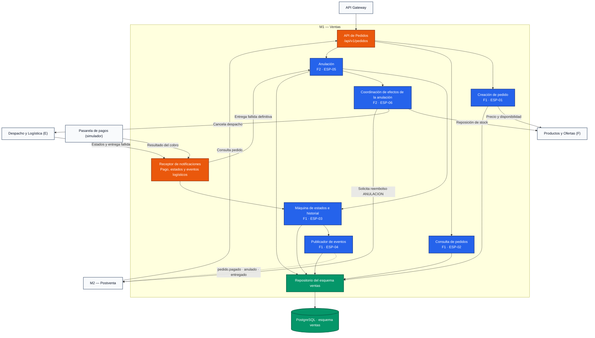
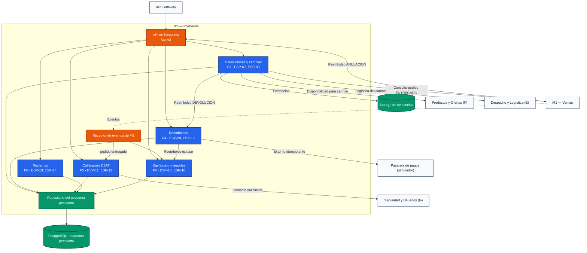

# Arquitectura C4: Diagrama de Componentes

> **Estado:** Propuesta para discusión del equipo, alineada con [specs/overview.md](../specs/overview.md) y los contratos de API. No reemplaza las especificaciones funcionales vigentes.

Este documento presenta el nivel 3 del modelo C4. Muestra los componentes internos de los dos microservicios descritos en [c4-nivel-2-contenedores-ventas-postventa.md](c4-nivel-2-contenedores-ventas-postventa.md) y la especificación que implementa cada uno.

## 1. Componentes de M1 — Ventas

| Componente | Responsabilidad | Especificación |
|---|---|---|
| API de Pedidos | Expone creación, consulta, listado y anulación del pedido; atiende las consultas internas de M2 | ESP-01, ESP-02, ESP-05 |
| Receptor de notificaciones | Recibe la notificación de pago, los cambios de estado y los eventos logísticos de Despacho; descarta duplicados | ESP-03, ESP-05 |
| Creación de pedido | Valida los bloques `canal`, `items`, `cupon`, `envio`, `contacto` y `pago`, y registra el pedido `CREADO` | ESP-01 |
| Consulta de pedidos | Detalle por identificador y listado por cliente, con control de propiedad | ESP-02 |
| Máquina de estados e historial | Único componente que cambia el estado; valida la matriz de transiciones y registra actor, motivo y fecha | ESP-03 |
| Publicador de eventos | Registra los eventos en la bandeja de salida y los entrega a M2 con reintentos | ESP-04 |
| Anulación | Valida el motivo tipificado; anula directo en `CREADO` o `PAGADO` y deja la solicitud pendiente del Gestor en `EN_PREPARACION` | ESP-05 |
| Coordinación de efectos de la anulación | Repone stock, cancela el despacho si existe y, si el pedido estaba pagado, solicita exactamente un reembolso a M2 | ESP-06 |
| Repositorio del esquema ventas | Acceso a pedido, detalle_pedido, pago, historial_estado, anulacion y bandeja de salida | ESP-01 a ESP-06 |

## 2. Componentes de M2 — Postventa

| Componente | Responsabilidad | Especificación |
|---|---|---|
| API de Postventa | Expone devoluciones, evidencias, reembolsos, CSAT, reclamos y métricas | ESP-07 a ESP-16 |
| Receptor de eventos de M1 | Recibe los eventos de M1 y descarta los ya procesados | ESP-11, ESP-15 |
| Devoluciones y cambios | Verifica con M1 que el pedido esté `ENTREGADO`, registra la solicitud con evidencias y dicta cambio, reembolso o rechazo | ESP-07, ESP-08 |
| Reembolsos | Acepta solo orígenes `ANULACION` (M1) y `DEVOLUCION` (F3), exige `X-Idempotency-Key`, controla el saldo reembolsable y registra cada intento | ESP-09, ESP-10 |
| Calificación CSAT | Genera la encuesta al recibir `pedido.entregado`, registra el puntaje y actualiza el CSAT | ESP-11, ESP-12 |
| Reclamos | Registra el reclamo con código de seguimiento y plazo de 15 días hábiles, y la respuesta visible al cliente | ESP-13, ESP-14 |
| Dashboard y reportes | Mantiene tablas agregadas a partir de eventos y sirve indicadores y exportaciones | ESP-15, ESP-16 |
| Repositorio del esquema postventa | Acceso a devolucion, evidencia_devolucion, reembolso, reclamo, calificacion y agregado_ventas | ESP-07 a ESP-16 |

## 3. Reglas de dependencia

- Solo la máquina de estados de M1 modifica el estado del pedido, incluida la anulación.
- M2 no accede al esquema `ventas`; consulta el pedido por la API de M1.
- Reembolsos solo se activa desde la anulación de M1 (`ANULACION`) o desde Devoluciones (`DEVOLUCION`).
- El dashboard lee tablas agregadas, nunca las tablas transaccionales.

## 4. Regla de lectura

Este diagrama responde únicamente a la pregunta **cómo se organiza cada microservicio por dentro**. Las clases, entidades y endpoints detallados pertenecen a las especificaciones funcionales, a los contratos de API y al código fuente.
