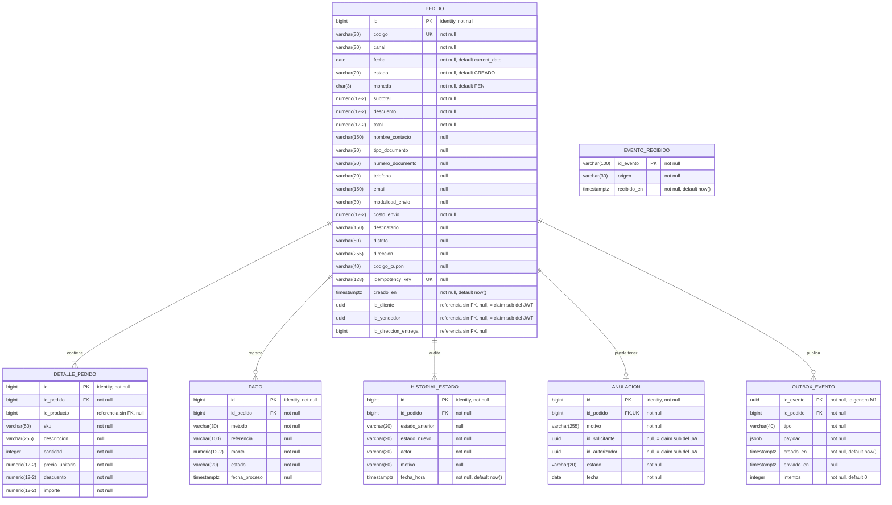

# Modelo físico - Ventas y Postventa

Implementación del [modelo lógico](diagrama-logico.md) en PostgreSQL 17 sobre Supabase (proyecto `nsfrwxrjidyckgfriyhv`). Incluye los tipos reales, valores por defecto, restricciones, índices y la configuración de seguridad. El script que crea todo es [ventas_postventa_schema.sql](../../../infra/bd/ventas_postventa_schema.sql), aplicado como la migración `crear_esquemas_ventas_postventa`.

> **Pendiente de aplicar en Supabase:** las columnas que referencian un usuario de Seguridad (`id_cliente`, `id_vendedor`, `id_solicitante`, `id_autorizador`) pasaron de `bigint` a `uuid`, confirmado por el módulo de Seguridad (`sub` del JWT es `uuid`) — ver `integraciones/CONSULTA_G7_SEGURIDAD.md`. Este documento y el script ya reflejan el tipo correcto; falta la migración real.

## 1. Diagrama

Esquema ventas (M1):

Esquema postventa (M2):

```mermaid
erDiagram
    DEVOLUCION ||--o{ EVIDENCIA_DEVOLUCION : adjunta
    DEVOLUCION ||--|{ DEVOLUCION_ITEM : contiene
    REEMBOLSO ||--|{ REEMBOLSO_INTENTO : registra
    DEVOLUCION {
        bigint id PK "identity, not null"
        bigint id_pedido "referencia sin FK, not null"
        uuid id_cliente "referencia sin FK, null, = claim sub del JWT"
        varchar(20) tipo "not null"
        varchar(255) motivo "not null"
        text descripcion "null"
        varchar(20) estado "not null"
        varchar(30) resolucion "null"
        uuid id_autorizador "null, = claim sub del JWT"
        text fundamento_rechazo "null"
        date fecha "not null"
    }
    DEVOLUCION_ITEM {
        bigint id PK "identity, not null"
        bigint id_devolucion FK "not null"
        bigint id_producto "referencia sin FK, not null"
        integer cantidad "not null"
    }
    EVIDENCIA_DEVOLUCION {
        bigint id PK "identity, not null"
        bigint id_devolucion FK "not null"
        varchar(500) url "not null"
        varchar(30) tipo "null"
        date fecha "not null"
    }
    REEMBOLSO {
        bigint id PK "identity, not null"
        bigint id_origen "referencia sin FK, not null"
        varchar(20) tipo_origen "not null"
        bigint id_pedido "referencia sin FK, null"
        varchar(100) idempotency_key UK "not null"
        numeric(12-2) monto "not null"
        char(3) moneda "not null, default PEN"
        varchar(100) id_transaccion "null"
        varchar(20) estado "not null, default PENDIENTE"
        uuid id_autorizador "null, = claim sub del JWT"
        date fecha "not null"
    }
    REEMBOLSO_INTENTO {
        bigint id PK "identity, not null"
        bigint id_reembolso FK "not null"
        integer numero_intento "not null"
        varchar(20) estado "not null"
        varchar(100) id_transaccion "null"
        text resultado "null"
        timestamptz fecha_hora "not null, default now()"
    }
    RECLAMO {
        bigint id PK "identity, not null"
        varchar(30) codigo UK "not null"
        bigint id_pedido "referencia sin FK, null"
        uuid id_cliente "referencia sin FK, null, = claim sub del JWT"
        varchar(20) tipo "not null"
        varchar(60) motivo "not null"
        text detalle "not null"
        varchar(150) nombre_consumidor "not null"
        varchar(20) documento "not null"
        varchar(150) email "null"
        varchar(20) telefono "null"
        varchar(20) estado "not null"
        integer plazo_dias_habiles "not null, default 15"
        timestamptz fecha_registro "not null, default now()"
        date fecha_limite_respuesta "not null"
        timestamptz fecha_atencion "null"
        varchar(50) atendido_por "null"
        text respuesta_visible_cliente "null"
        varchar(20) canal "not null"
    }
    CALIFICACION {
        bigint id PK "identity, not null"
        bigint id_pedido UK "referencia sin FK, not null"
        integer puntaje "not null"
        text comentario "null"
        varchar(30) canal "not null"
        date fecha "not null"
    }
    AGREGADO_VENTAS {
        varchar(7) periodo PK "not null"
        varchar(30) canal PK "not null"
        uuid id_vendedor PK "not null, = claim sub del JWT"
        bigint id_producto PK "not null"
        integer unidades "not null"
        numeric(14-2) monto "not null"
        timestamptz actualizado_en "not null, default now()"
    }
    AGREGADO_METRICAS {
        date fecha PK "not null"
        varchar(20) canal PK "not null"
        integer pedidos_pagados "not null, default 0"
        integer pedidos_anulados "not null, default 0"
        integer pedidos_entregados "not null, default 0"
        integer devoluciones_aprobadas "not null, default 0"
        numeric(14-2) monto_reembolsado_pen "not null, default 0"
        integer csat_suma "not null, default 0"
        integer csat_cantidad "not null, default 0"
        integer reclamos_registrados "not null, default 0"
        integer reclamos_atendidos "not null, default 0"
        timestamptz actualizado_en "not null, default now()"
    }
    EVENTO_RECIBIDO {
        uuid id_evento PK "not null, el idEvento de M1"
        varchar(40) tipo "not null"
        timestamptz recibido_en "not null, default now()"
    }
```

Los tipos numéricos se escriben como numeric(12-2) porque Mermaid no admite comas; en la base son numeric(12,2).

Archivo editable: [diagrama-fisico.drawio](diagrama-fisico.drawio)

## 2. Esquemas

| Esquema | Microservicio | Tablas |
|---|---|---|
| ventas | M1 | pedido, detalle_pedido, pago, historial_estado, anulacion, outbox_evento, evento_recibido |
| postventa | M2 | devolucion, devolucion_item, evidencia_devolucion, reembolso, reembolso_intento, reclamo, calificacion, agregado_ventas, agregado_metricas, evento_recibido |

No hay claves foráneas entre los dos esquemas.

## 3. Tipos de datos

| Lógico | PostgreSQL | Uso |
|---|---|---|
| BIGINT (PK) | bigint generated always as identity | Identificadores; la base genera el valor |
| BIGINT | bigint | Claves foráneas y referencias a otros módulos |
| INTEGER | integer | cantidad, puntaje, unidades, plazo_dias_habiles |
| DECIMAL(12,2) | numeric(12,2) | Montos (agregado_ventas.monto usa numeric(14,2)) |
| VARCHAR(n) | varchar(n) | Códigos, estados y textos cortos |
| CHAR(3) | char(3) | moneda (código ISO, por ejemplo PEN) |
| TEXT | text | Textos largos: detalle, comentario, fundamento_rechazo, respuesta |
| DATE | date | Fechas sin hora |
| TIMESTAMP | timestamptz | Fecha y hora con zona horaria |
| UUID | uuid | Identificador de evento de dominio (outbox_evento.id_evento, postventa.evento_recibido.id_evento) |
| JSONB | jsonb | outbox_evento.payload: el cuerpo del evento tal como se envía a M2 |

## 4. Valores por defecto

| Tabla | Columna | Valor |
|---|---|---|
| pedido | fecha | current_date |
| pedido | estado | 'CREADO' |
| pedido | moneda | 'PEN' |
| pedido | subtotal, descuento, total, costo_envio | 0 |
| pedido | creado_en | now() |
| detalle_pedido | descuento | 0 |
| historial_estado | fecha_hora | now() |
| anulacion, devolucion, evidencia_devolucion, calificacion, reembolso | fecha | current_date |
| reembolso | moneda | 'PEN' |
| reembolso | estado | 'PENDIENTE' |
| reclamo | plazo_dias_habiles | 15 |
| reclamo | fecha_registro | now() |
| agregado_ventas | unidades, monto | 0 |
| agregado_ventas | actualizado_en | now() |
| outbox_evento | creado_en | now() |
| outbox_evento | intentos | 0 |
| evento_recibido (ventas y postventa) | recibido_en | now() |
| reembolso_intento | fecha_hora | now() |
| agregado_metricas | todos los contadores y el monto | 0 |
| agregado_metricas | actualizado_en | now() |

## 5. Restricciones

Claves primarias: todas las tablas usan `id`, salvo agregado_ventas (clave compuesta periodo, canal, id_vendedor, id_producto), agregado_metricas (clave compuesta fecha, canal) y las tablas de eventos (`ventas.outbox_evento`, `ventas.evento_recibido` y `postventa.evento_recibido`), cuya clave primaria es `id_evento`.

Claves foráneas (todas con `ON DELETE CASCADE`):

| Tabla | Columna | Referencia |
|---|---|---|
| ventas.detalle_pedido | id_pedido | ventas.pedido(id) |
| ventas.pago | id_pedido | ventas.pedido(id) |
| ventas.historial_estado | id_pedido | ventas.pedido(id) |
| ventas.anulacion | id_pedido | ventas.pedido(id) |
| ventas.outbox_evento | id_pedido | ventas.pedido(id) |
| postventa.evidencia_devolucion | id_devolucion | postventa.devolucion(id) |
| postventa.devolucion_item | id_devolucion | postventa.devolucion(id) |
| postventa.reembolso_intento | id_reembolso | postventa.reembolso(id) |

Valores únicos:

| Nombre | Tabla | Columnas |
|---|---|---|
| pedido_codigo_key | ventas.pedido | codigo |
| pedido_idempotency_key_key | ventas.pedido | idempotency_key |
| anulacion_id_pedido_key | ventas.anulacion | id_pedido |
| reclamo_codigo_key | postventa.reclamo | codigo |
| reembolso_idempotency_key_key | postventa.reembolso | idempotency_key |
| uq_reembolso_origen | postventa.reembolso | tipo_origen, id_origen |
| uq_reembolso_intento | postventa.reembolso_intento | id_reembolso, numero_intento |
| calificacion_id_pedido_key | postventa.calificacion | id_pedido |

CHECK:

| Nombre | Tabla | Condición |
|---|---|---|
| ck_pedido_estado | ventas.pedido | estado IN (CREADO, PAGADO, EN_PREPARACION, DESPACHADO, ENTREGADO, ANULADO) |
| ck_pedido_canal | ventas.pedido | canal IN (MARKETPLACE, CHATBOT, RETAIL) |
| ck_pedido_montos | ventas.pedido | subtotal, descuento, total y costo_envio ≥ 0 |
| ck_detalle_cantidad | ventas.detalle_pedido | cantidad > 0 |
| ck_detalle_montos | ventas.detalle_pedido | precio_unitario, descuento e importe ≥ 0 |
| ck_pago_monto | ventas.pago | monto ≥ 0 |
| ck_pago_estado | ventas.pago | estado IN (PENDIENTE, CONFIRMADO, RECHAZADO) |
| ck_historial_actor | ventas.historial_estado | actor IN (CLIENTE, GESTOR, CANAL_CHATBOT, PASARELA_PAGOS, SISTEMA_LOGISTICA) |
| ck_anulacion_estado | ventas.anulacion | estado IN (PENDIENTE_AUTORIZACION, EJECUTADA, RECHAZADA) |
| ck_outbox_tipo | ventas.outbox_evento | tipo IN (pedido.pagado, pedido.anulado, pedido.entregado) |
| ck_evento_recibido_origen | ventas.evento_recibido | origen IN (PASARELA_PAGOS, SISTEMA_LOGISTICA) |
| ck_devolucion_estado | postventa.devolucion | estado IN (SOLICITADA, EN_EVALUACION, APROBADA, RECHAZADA, COMPLETADA) |
| ck_devolucion_item_cantidad | postventa.devolucion_item | cantidad > 0 |
| ck_reembolso_tipo_origen | postventa.reembolso | tipo_origen IN (ANULACION, DEVOLUCION) |
| ck_reembolso_estado | postventa.reembolso | estado IN (PENDIENTE, EXITOSO, FALLIDO) |
| ck_reembolso_monto | postventa.reembolso | monto > 0 |
| ck_reembolso_intento_estado | postventa.reembolso_intento | estado IN (PENDIENTE, EXITOSO, FALLIDO) |
| ck_reclamo_plazo | postventa.reclamo | plazo_dias_habiles > 0 |
| ck_reclamo_estado | postventa.reclamo | estado IN (REGISTRADO, EN_PROCESO, ATENDIDO, DERIVADO) |
| ck_reclamo_canal | postventa.reclamo | canal IN (MARKETPLACE, CHATBOT, RETAIL) |
| ck_calificacion_puntaje | postventa.calificacion | puntaje entre 1 y 5 |
| ck_calificacion_canal | postventa.calificacion | canal IN (MARKETPLACE, CHATBOT, RETAIL) |
| ck_agregado_metricas_canal | postventa.agregado_metricas | canal IN (MARKETPLACE, CHATBOT, RETAIL) |

## 6. Índices

Además de los que PostgreSQL crea para las claves primarias y únicas:

| Índice | Tabla | Columna |
|---|---|---|
| ix_detalle_pedido_id_pedido | ventas.detalle_pedido | id_pedido |
| ix_pago_id_pedido | ventas.pago | id_pedido |
| ix_historial_estado_id_pedido | ventas.historial_estado | id_pedido |
| ix_evidencia_id_devolucion | postventa.evidencia_devolucion | id_devolucion |
| ix_devolucion_id_pedido | postventa.devolucion | id_pedido |
| ix_reclamo_id_pedido | postventa.reclamo | id_pedido |
| ix_outbox_pendientes | ventas.outbox_evento | creado_en, solo filas con enviado_en null (índice parcial) |
| ix_devolucion_id_cliente | postventa.devolucion | id_cliente |
| ix_reembolso_id_pedido | postventa.reembolso | id_pedido |
| ix_devolucion_item_id_devolucion | postventa.devolucion_item | id_devolucion |

Los tres primeros sirven para buscar por pedido en M2 aunque esas columnas no sean claves foráneas. `ix_outbox_pendientes` sirve al `EnvioEventosScheduler` para traer los eventos no enviados más antiguos. `ix_reembolso_id_pedido` sirve para calcular el saldo reembolsable de un pedido (ESP-09).

## 7. Seguridad

- RLS (Row Level Security) activo en las 17 tablas (7 en `ventas`, 10 en `postventa`), sin políticas. La API pública de Supabase no puede leer ni escribir en ellas.
- El backend se conecta directamente a PostgreSQL con su propia credencial.
- Pendiente: crear un usuario de base de datos para M1 y otro para M2, cada uno con permisos solo sobre su esquema.

## 8. Pendientes

- El `.drawio` de este diagrama todavía no incluye `outbox_evento`, `evento_recibido` (ambos esquemas), `devolucion_item`, `reembolso_intento` ni `agregado_metricas`, ni sus índices y CHECK — pendiente de que quien lo mantiene lo actualice y reexporte las imágenes.

## 9. Otros modelos

| Modelo | Archivo |
|---|---|
| Conceptual | [diagrama-conceptual.md](diagrama-conceptual.md) |
| Lógico | [diagrama-logico.md](diagrama-logico.md) |
