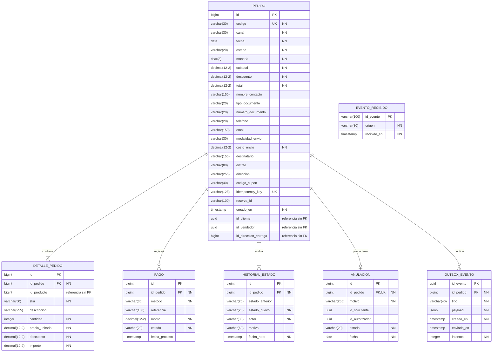

# Modelo lógico - Ventas y Postventa

Pasa las entidades del [modelo conceptual](diagrama-conceptual.md) a tablas, con columnas, tipos, claves y campos obligatorios. Los nombres son los mismos del script [ventas_postventa_schema.sql](../../../infra/bd/ventas_postventa_schema.sql).

| Esquema | Microservicio | Tablas |
|---|---|---|
| ventas | M1 | pedido, detalle_pedido, pago, historial_estado, anulacion, outbox_evento, evento_recibido |
| postventa | M2 | devolucion, devolucion_item, evidencia_devolucion, reembolso, reembolso_intento, reclamo, calificacion, agregado_ventas, agregado_metricas, evento_recibido |

> `outbox_evento` y `evento_recibido` (ambos esquemas), `devolucion_item`, `reembolso_intento` y `agregado_metricas` ya están aplicadas en Supabase — confirmado en el código real de `servicio-ventas` y en la guía de implementación del backend compartida por el equipo (no versionada en este repo). El `.drawio` todavía no refleja estos cambios; queda pendiente que quien lo mantiene lo actualice y reexporte las imágenes.

## 1. Diagrama

Esquema ventas (M1):



Esquema postventa (M2):

```mermaid
erDiagram
    DEVOLUCION ||--o{ EVIDENCIA_DEVOLUCION : adjunta
    DEVOLUCION ||--|{ DEVOLUCION_ITEM : contiene
    REEMBOLSO ||--|{ REEMBOLSO_INTENTO : registra
    DEVOLUCION {
        bigint id PK
        bigint id_pedido "referencia sin FK, NN"
        uuid id_cliente "referencia sin FK"
        varchar(20) tipo "NN"
        varchar(255) motivo "NN"
        text descripcion
        varchar(20) estado "NN"
        varchar(30) resolucion
        uuid id_autorizador
        text fundamento_rechazo
        date fecha "NN"
    }
    DEVOLUCION_ITEM {
        bigint id PK
        bigint id_devolucion FK "NN"
        bigint id_producto "referencia sin FK, NN"
        integer cantidad "NN"
    }
    EVIDENCIA_DEVOLUCION {
        bigint id PK
        bigint id_devolucion FK "NN"
        varchar(500) url "NN"
        varchar(30) tipo
        date fecha "NN"
    }
    REEMBOLSO {
        bigint id PK
        bigint id_origen "referencia sin FK, NN"
        varchar(20) tipo_origen "NN"
        bigint id_pedido "referencia sin FK"
        varchar(100) idempotency_key UK "NN"
        decimal(12-2) monto "NN"
        char(3) moneda "NN"
        varchar(100) id_transaccion
        varchar(20) estado "NN"
        uuid id_autorizador
        date fecha "NN"
    }
    REEMBOLSO_INTENTO {
        bigint id PK
        bigint id_reembolso FK "NN"
        integer numero_intento "NN"
        varchar(20) estado "NN"
        varchar(100) id_transaccion
        text resultado
        timestamp fecha_hora "NN"
    }
    RECLAMO {
        bigint id PK
        varchar(30) codigo UK "NN"
        bigint id_pedido "referencia sin FK"
        uuid id_cliente "referencia sin FK"
        varchar(20) tipo "NN"
        varchar(60) motivo "NN"
        text detalle "NN"
        varchar(150) nombre_consumidor "NN"
        varchar(20) documento "NN"
        varchar(150) email
        varchar(20) telefono
        varchar(20) estado "NN"
        integer plazo_dias_habiles "NN"
        timestamp fecha_registro "NN"
        date fecha_limite_respuesta "NN"
        timestamp fecha_atencion
        varchar(50) atendido_por
        text respuesta_visible_cliente
        varchar(20) canal "NN"
    }
    CALIFICACION {
        bigint id PK
        bigint id_pedido UK "referencia sin FK, NN"
        integer puntaje "NN"
        text comentario
        varchar(30) canal "NN"
        date fecha "NN"
    }
    AGREGADO_VENTAS {
        varchar(7) periodo PK
        varchar(30) canal PK
        uuid id_vendedor PK
        bigint id_producto PK
        integer unidades "NN"
        decimal(14-2) monto "NN"
        timestamp actualizado_en "NN"
    }
    AGREGADO_METRICAS {
        date fecha PK
        varchar(20) canal PK
        integer pedidos_pagados "NN"
        integer pedidos_anulados "NN"
        integer pedidos_entregados "NN"
        integer devoluciones_aprobadas "NN"
        decimal(14-2) monto_reembolsado_pen "NN"
        integer csat_suma "NN"
        integer csat_cantidad "NN"
        integer reclamos_registrados "NN"
        integer reclamos_atendidos "NN"
        timestamp actualizado_en "NN"
    }
    EVENTO_RECIBIDO {
        uuid id_evento PK
        varchar(40) tipo "NN"
        timestamp recibido_en "NN"
    }
```



Los tipos decimal(12-2) equivalen a DECIMAL(12,2); Mermaid no admite comas en el tipo.

Archivo editable: [diagrama-logico.drawio](diagrama-logico.drawio)

## 2. Notación

| Marca | Significado |
|---|---|
| PK | Clave primaria |
| FK | Clave foránea dentro del mismo esquema |
| UK | Valor único |
| R | Referencia a otro microservicio o módulo, sin clave foránea |
| NN | Obligatorio (NOT NULL) |

Los tipos DECIMAL y TIMESTAMP se implementan en PostgreSQL como numeric y timestamptz.

## 3. Esquema relacional

PK entre [ ], FK con →, referencia sin FK con ⇢.

ventas (M1):

```text
pedido           ([id], codigo UK, canal, fecha, estado, moneda, subtotal, descuento, total,
                  nombre_contacto, tipo_documento, numero_documento, telefono, email,
                  modalidad_envio, costo_envio, destinatario, distrito, direccion, codigo_cupon,
                  idempotency_key UK, reserva_id ⇢ F, creado_en, id_cliente ⇢ G, id_vendedor ⇢ G, id_direccion_entrega ⇢ E)

detalle_pedido   ([id], id_pedido → pedido.id, id_producto ⇢ F, sku, descripcion, cantidad,
                  precio_unitario, descuento, importe)

pago             ([id], id_pedido → pedido.id, metodo, referencia, monto, estado, fecha_proceso)

historial_estado ([id], id_pedido → pedido.id, estado_anterior, estado_nuevo, actor, motivo,
                  fecha_hora)

anulacion        ([id], id_pedido → pedido.id UK, motivo, id_solicitante, id_autorizador,
                  estado, fecha)

outbox_evento    ([id_evento], id_pedido → pedido.id, tipo, payload, creado_en, enviado_en,
                  intentos)

evento_recibido  ([id_evento], origen, recibido_en)
```

postventa (M2):

```text
devolucion           ([id], id_pedido ⇢ M1.pedido, id_cliente ⇢ G, tipo, motivo, descripcion,
                      estado, resolucion, id_autorizador, fundamento_rechazo, fecha)

devolucion_item      ([id], id_devolucion → devolucion.id, id_producto ⇢ F, cantidad)

evidencia_devolucion ([id], id_devolucion → devolucion.id, url, tipo, fecha)

reembolso            ([id], id_origen ⇢ M1.anulacion | devolucion, tipo_origen,
                      id_pedido ⇢ M1.pedido, idempotency_key UK, monto, moneda, id_transaccion,
                      estado, id_autorizador, fecha)    UK (tipo_origen, id_origen)

reembolso_intento    ([id], id_reembolso → reembolso.id, numero_intento, estado,
                      id_transaccion, resultado, fecha_hora)    UK (id_reembolso, numero_intento)

reclamo              ([id], codigo UK, id_pedido ⇢ M1.pedido, id_cliente ⇢ G, tipo, motivo,
                      detalle, nombre_consumidor, documento, email, telefono, estado,
                      plazo_dias_habiles, fecha_registro, fecha_limite_respuesta,
                      fecha_atencion, atendido_por, respuesta_visible_cliente, canal)

calificacion         ([id], id_pedido ⇢ M1.pedido UK, puntaje, comentario, canal, fecha)

agregado_ventas      ([periodo, canal, id_vendedor, id_producto], unidades, monto, actualizado_en)

agregado_metricas    ([fecha, canal], pedidos_pagados, pedidos_anulados, pedidos_entregados,
                      devoluciones_aprobadas, monto_reembolsado_pen, csat_suma, csat_cantidad,
                      reclamos_registrados, reclamos_atendidos, actualizado_en)

evento_recibido      ([id_evento], tipo, recibido_en)
```

## 4. Relaciones

Con clave foránea:

| Padre | Hija | Columna | Cardinalidad | Al borrar el padre |
|---|---|---|---|---|
| pedido | detalle_pedido | id_pedido | 1 a 1..N | Se borran los detalles |
| pedido | pago | id_pedido | 1 a 0..N | Se borran los pagos |
| pedido | historial_estado | id_pedido | 1 a 1..N | Se borra el historial |
| pedido | anulacion | id_pedido (UK) | 1 a 0..1 | Se borra la anulación |
| pedido | outbox_evento | id_pedido | 1 a 0..N | Se borran los eventos pendientes de envío |
| devolucion | evidencia_devolucion | id_devolucion | 1 a 0..N | Se borran las evidencias |
| devolucion | devolucion_item | id_devolucion | 1 a 1..N | Se borran los ítems |
| reembolso | reembolso_intento | id_reembolso | 1 a 1..N | Se borran los intentos |

El mínimo de 1 en detalle_pedido e historial_estado viene de ESP-01; el de devolucion_item viene de la misma lógica aplicada a F3. La base no lo puede exigir; lo controla cada servicio al crear el registro.

Sin clave foránea:

| Columna | Apunta a | Motivo |
|---|---|---|
| devolucion.id_pedido | ventas.pedido | Está en otro microservicio; se valida con la API de M1 |
| devolucion.id_cliente | Módulo G | Usuarios de Seguridad y Usuarios |
| devolucion_item.id_producto | Módulo F | Catálogo de Productos y Ofertas |
| reembolso.id_pedido | ventas.pedido | Para controlar el saldo reembolsable del pedido (ESP-09) |
| reclamo.id_pedido | ventas.pedido | Igual que el anterior; es opcional |
| reclamo.id_cliente | Módulo G | Usuarios de Seguridad y Usuarios |
| calificacion.id_pedido | ventas.pedido | Igual que el anterior; es único |
| reembolso.id_origen | ventas.anulacion o postventa.devolucion | Depende de tipo_origen y una de las tablas está en M1 |
| pedido.id_cliente, pedido.id_vendedor | Módulo G | Usuarios de Seguridad y Usuarios |
| pedido.id_direccion_entrega | Módulo E | Dato de Despacho y Entrega |
| detalle_pedido.id_producto | Módulo F | Catálogo de Productos y Ofertas |

## 5. Reglas

M1:

1. pedido.codigo es único. pedido.idempotency_key también (acuerdo H-02): una misma cabecera Idempotency-Key no crea dos pedidos; es null en pedidos anteriores al acuerdo.
   pedido.reserva_id es el reservaId que asigna Productos (F) al confirmar la reserva de stock (acuerdo G6); es null mientras la reserva está pendiente y siempre en RETAIL.
2. pedido.estado solo admite CREADO, PAGADO, EN_PREPARACION, DESPACHADO, ENTREGADO y ANULADO. Las transiciones las controla M1 (ESP-03).
3. Un pedido tiene como máximo una anulación.
4. detalle_pedido.cantidad es mayor que cero y los montos no pueden ser negativos.
5. historial_estado solo recibe inserciones.
6. pago.estado solo admite PENDIENTE, CONFIRMADO y RECHAZADO (restricción `ck_pago_estado` en Supabase y enum `EstadoPago` de `servicio-ventas`).
7. pedido.canal solo admite MARKETPLACE, CHATBOT y RETAIL (enum `CanalVenta`).
8. anulacion.estado solo admite PENDIENTE_AUTORIZACION, EJECUTADA y RECHAZADA.
9. outbox_evento.id_evento es la clave primaria (la genera M1); un evento no se marca `enviado_en` hasta que M2 confirma la recepción (ver evento_recibido en postventa).
10. evento_recibido.id_evento es la clave primaria; evita que una misma notificación externa (pasarela o Despacho) duplique una transición.

M2:

1. Solo se registra una devolución para un pedido ENTREGADO; M2 lo consulta a M1.
2. devolucion.resolucion es cambio, reembolso o rechazo.
3. devolucion.estado solo admite SOLICITADA, EN_EVALUACION, APROBADA, RECHAZADA y COMPLETADA.
4. devolucion_item.cantidad es mayor que cero; una devolución tiene al menos un ítem.
5. reembolso.tipo_origen solo admite ANULACION o DEVOLUCION, y (tipo_origen, id_origen) es único.
6. reembolso.idempotency_key es única para que un reintento no genere otro pago (ESP-09).
7. reembolso.estado solo admite PENDIENTE, EXITOSO o FALLIDO.
8. reembolso.id_pedido se usa para calcular el saldo reembolsable del pedido (suma de intentos EXITOSO y PENDIENTE del mismo pedido no puede superar su total).
9. (id_reembolso, numero_intento) es único en reembolso_intento; nunca se edita ni se borra un intento ya registrado (ESP-10).
10. reclamo.codigo es único. reclamo.estado solo admite REGISTRADO, EN_PROCESO, ATENDIDO y DERIVADO; pasa de REGISTRADO a EN_PROCESO y llega a ATENDIDO solo con respuesta visible al cliente (ESP-13, ESP-14).
11. reclamo.plazo_dias_habiles es 15 por defecto.
12. calificacion.puntaje va de 1 a 5, con una calificación por pedido.
13. agregado_ventas se actualiza con eventos.
14. agregado_metricas tiene como máximo una fila por (fecha, canal); se actualiza con upsert a partir de eventos y de las acciones de F3 a F6.
15. evento_recibido.id_evento es la clave primaria; evita reprocesar un evento de M1 ya aplicado a los agregados.

## 6. Tablas por funcionalidad

| Funcionalidad | Tablas |
|---|---|
| F1 Ciclo de vida del pedido | pedido, detalle_pedido, pago, historial_estado, outbox_evento, evento_recibido (ventas) |
| F2 Anulación de pedidos | anulacion, pedido, historial_estado |
| F3 Devoluciones y cambios | devolucion, devolucion_item, evidencia_devolucion |
| F4 Reembolsos y extornos | reembolso, reembolso_intento |
| F5 Calificación de experiencia | calificacion, evento_recibido (postventa) |
| F6 Reclamos, dashboard y reportes | reclamo, agregado_ventas, agregado_metricas |

## 7. Pendientes

- El `.drawio` de este diagrama todavía no incluye `outbox_evento`, `evento_recibido`, `devolucion_item`, `reembolso_intento` ni `agregado_metricas`, ni las columnas nuevas de `devolucion` y `reclamo` (sí tiene los `uuid` y `pedido.idempotency_key`) — pendiente de que quien lo mantiene lo actualice y reexporte las imágenes.

## 8. Otros modelos

| Modelo | Archivo |
|---|---|
| Conceptual | [diagrama-conceptual.md](diagrama-conceptual.md) |
| Físico | [diagrama-fisico.md](diagrama-fisico.md) |
